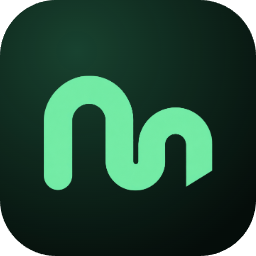
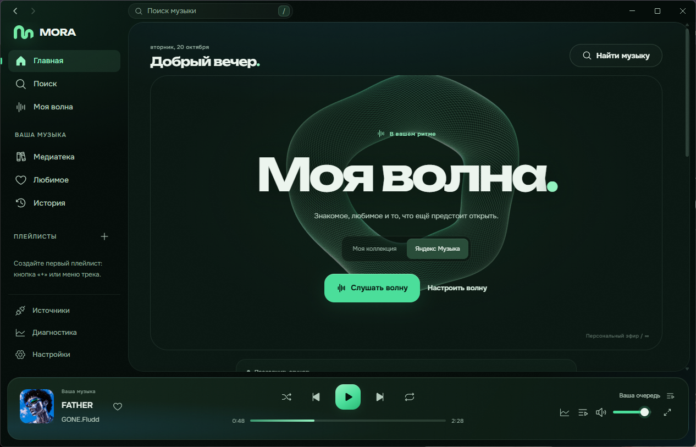
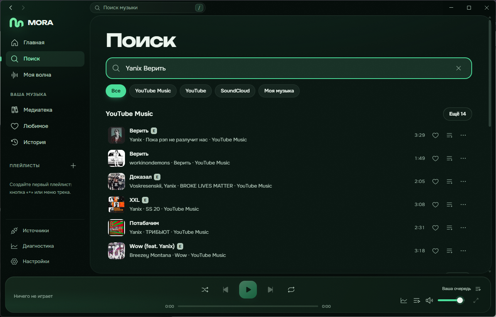
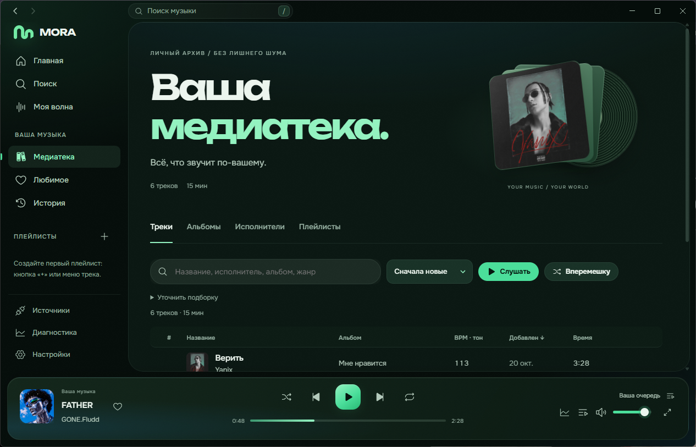
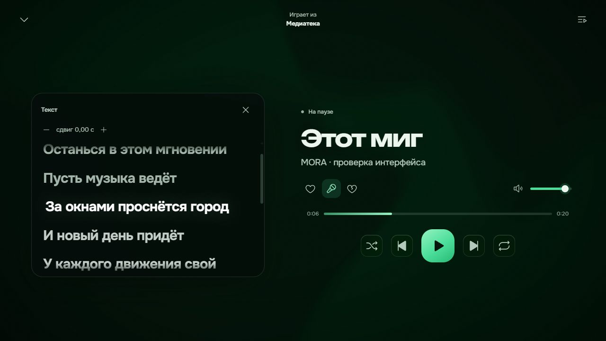
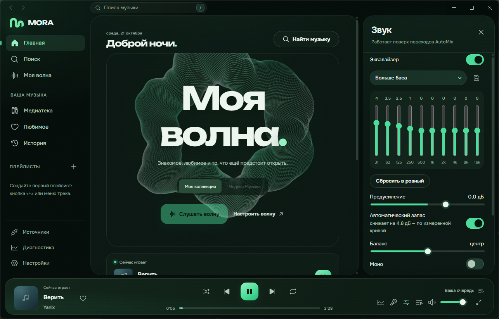
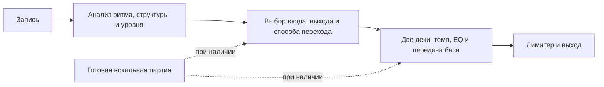

<div align="center">



# MORA

Музыка в вашем ритме.<br>
Плеер для Windows с DJ-переходами AutoMix, своей медиатекой и персональной волной.

[](https://github.com/Rizen1322/MORA/releases/latest)
[](https://github.com/Rizen1322/MORA/releases)
[](https://github.com/Rizen1322/MORA/actions/workflows/ci.yml)


**[Скачать MORA для Windows](https://github.com/Rizen1322/MORA/releases/latest)** · [Возможности](#что-умеет) · [Документация](docs/README.md) · [Сообщить об ошибке](https://github.com/Rizen1322/MORA/issues/new?template=bug_report.yml)

<br>



</div>

## Что умеет

- **AutoMix.** Подбирает способ и момент перехода, совмещает ритм, плавно передаёт бас и громкость. Для подходящих записей использует локально подготовленную вокальную партию.
- **Своя музыка.** Импорт файлов и папок, плейлисты, избранное, история и загрузки для офлайн-прослушивания.
- **Поиск музыки.** YouTube Music, YouTube и SoundCloud, страницы артистов и альбомов. Поддержка онлайн-источников экспериментальная и зависит от их доступности.
- **Моя волна.** Непрерывная очередь с учётом предпочтений и настроек подбора следующего трека.
- **Звук под себя.** 10-полосный эквалайзер, пресеты, баланс, моно, реверберация, независимые скорость и высота тона.
- **Тексты.** Текст песни внутри полноэкранного плеера; синхронизация доступна, когда её предоставляет источник.
- **Импорт плейлистов.** Публичные списки Spotify, Apple Music и YouTube, а также файлы плейлистов. Spotify и Apple Music здесь служат источниками метаданных, не аудио.
- **Настольное приложение.** Трей, компактный режим и медиаклавиши. Для готовой сборки не нужно отдельно устанавливать Node.js, Python или FFmpeg.

## Как это выглядит

<table>
<tr>
<td width="50%"></td>
<td width="50%"></td>
</tr>
<tr>
<td align="center"><sub>Поиск. Онлайн-записи и ваша коллекция в одном интерфейсе</sub></td>
<td align="center"><sub>Медиатека. Треки, альбомы и сохранённая музыка</sub></td>
</tr>
<tr>
<td width="50%"></td>
<td width="50%"></td>
</tr>
<tr>
<td align="center"><sub>Плеер. Музыка и текст без лишних панелей</sub></td>
<td align="center"><sub>Звук. Эквалайзер, усиление и баланс</sub></td>
</tr>
</table>

Снимки сделаны в настольной версии на разных этапах разработки; отдельные детали текущей сборки могут отличаться.

## Установка

1. Откройте [последний релиз](https://github.com/Rizen1322/MORA/releases/latest) и скачайте `MORA-Setup-<версия>.exe`.
2. Запустите установщик и выберите папку. Установка выполняется для текущего пользователя.
3. Откройте MORA и добавьте свою музыку или воспользуйтесь поиском.

Поддерживается Windows 10/11 x64. В установщик включены FFmpeg, yt-dlp и CPU-комплект подготовки вокальных партий. Подготовка вокала требует времени и ресурсов; качество перехода зависит от музыки и результатов анализа.

Сборка пока **не подписана сертификатом**, поэтому Windows может показать предупреждение SmartScreen. SHA-256 установщика приложен к релизу. Начиная с 0.3.14 приложение автоматически проверяет новые версии через GitHub; загрузка и перезапуск выполняются по вашему выбору. С 0.3.13 нужно один раз обновиться вручную. [Как устроено обновление](docs/AUTO_UPDATE.md).

Медиатека хранится в `%LOCALAPPDATA%\MORA\data`. Перед переносом на другой компьютер сделайте её резервную копию. [Подробности использования](docs/USER_GUIDE.md).

## Как работает AutoMix



Анализ и микшер работают локально. Устойчивая ритмическая сетка позволяет сводить по битам; для других пар планировщик выбирает иной переход. Граница музыкальной секции не означает распознанный конец строки, а AutoMix не гарантирует идеальное сведение любых двух песен.

## Сборка из исходников

Нужны Windows x64, Node.js ≥ 22.13 и Python 3.12 **на машине сборки** для подготовки автономного CPU-комплекта.

```powershell
npm ci
node apps/desktop/scripts/fetch-ffmpeg.mjs
node apps/desktop/scripts/fetch-ytdlp.mjs
node apps/desktop/scripts/fetch-vocals.mjs --python C:/Python312/python.exe
npm run desktop:package
```

Установщик появится в `apps/desktop/dist/`. [Разработка, тесты и выпуск версий](docs/DEVELOPMENT.md).

## Устройство репозитория

```text
apps/
  desktop/       Electron: окно, трей, сборка и интеграция с Windows
  server/        Локальный API, медиатека, источники и фоновые задания
  web/           Интерфейс React и AudioWorklet
packages/
  core/          DSP, анализ музыки, планировщик и рекомендатель
tools/           Генераторы тестовых записей и инструменты проверки
docs/            Руководства, архитектура, технические заметки и снимки
.github/         Проверки и шаблон сообщения об ошибке
```

В этом репозитории публикуется настольная версия. Пользовательская музыка, базы, токены, модели и сгенерированные сборки не хранятся в Git; готовые установщики находятся в Releases.

Сторонние компоненты и их лицензии перечислены в [THIRD_PARTY.md](THIRD_PARTY.md).
