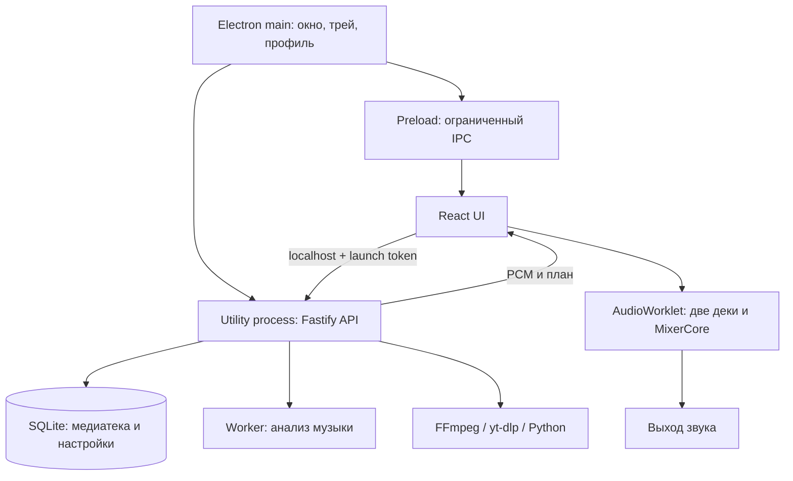

# Архитектура настольной версии

## Границы компонентов

`apps/desktop` управляет окном, треем, одиночным экземпляром, профилем, запуском локального backend и упаковкой. Renderer работает с изоляцией контекста и без Node integration; preload предоставляет фиксированные IPC-вызовы.

`apps/server` хранит медиатеку в SQLite, импортирует записи, получает метаданные и PCM, запускает анализ и локальную подготовку вокала. В desktop-сборке сервер слушает loopback на выбранном порту; main добавляет launch token к запросам своего origin.

`apps/web` содержит React-интерфейс и контроллер аудио. Микшер выполняется в AudioWorklet; изменение очереди и перемотки должно отменять устаревшую подготовку.

`packages/core` содержит DSP, MIR, планировщик переходов и логику рекомендаций. Исходная запись и корректировки вокальной партии проходят общий стерео time stretcher. Качество музыкального плана и своевременная поставка PCM — отдельные требования.

## Подготовка сборки

`apps/desktop/scripts/build.mjs` отдельно собирает веб-интерфейс и backend, копирует локальные инструменты и подготовленные vendor-комплекты в `apps/desktop/build`. Затем electron-builder создаёт NSIS-установщик и `win-unpacked`.

Vendor-файлы и итоговые бинарные сборки не коммитятся. Пользовательские профили не участвуют в сборке. Приложение не требует внешнего сервера для собственной медиатеки; онлайн-поиск обращается к внешним сервисам.
