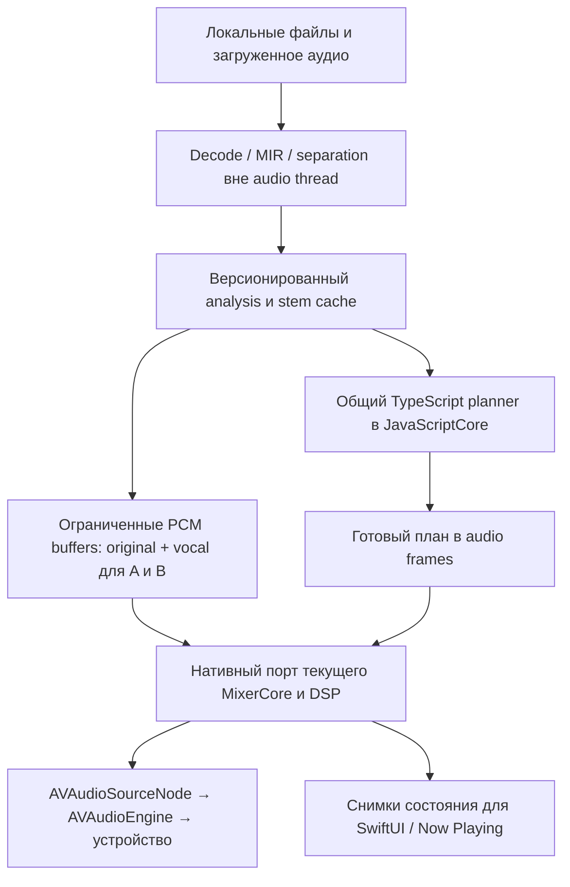

# План AutoMix на iOS для iPhone 12–13

Исследование от 22 октября 2026, выделенное из общего документа. Цель — самостоятельное нативное приложение с качеством подготовленных переходов не хуже зафиксированного ПК-эталона. Это план переноса, а не готовая реализация или доказанная скорость на устройстве.

Оптимизация текущего ПК-приложения описана в [отдельном плане](optimization-plan-2026-10-22.md). Здесь сохранены необходимые общие критерии качества, мобильная архитектура, подготовка, фон и приёмка.

**Актуализация после desktop-исправлений**

[Отчёт исправлений](audit-fixes-2026-10-22.md) сверен с исходниками. Повторный независимый прогон: typecheck проходит, Vitest **810/810 в 93 файлах**. Bundled planner теперь соответствует am-analyzer-12/am-planner-v11-dj-7; это устраняет прежнюю устаревшую копию, но не добавляет исполнение AutoMix в NativePlayer.

Для сравнения с iOS зафиксировать новый ПК-эталон после анализа версии 12. WAV v2 из [разбора резких входов](automix-abrupt-entries-2026-10-22.md) созданы с анализами 11 и не являются полной приёмкой текущего состояния.

В desktop preparation уже удалены часть полных копий, power и compaction обрабатываются блоками. Полный streaming и глобальная нормализация по блокам ещё впереди. MAX_FRAMES=2400 ограничивает память MIR, но после 20 мин меняет разрешение структуры; для parity сравнивать один и тот же алгоритм и отдельно принимать качество длинных записей.

Drums/bass из [исследования идей](automix-ideas-2026-10-22.md) пока не добавлять в обязательный iPhone-контракт. Сначала доказать пользу на ПК: новый inference forward не нужен, но добавляются буферы, transfer, overlap-add, I/O и DSP. При успешном эксперименте расширять manifest/маски версионированно, с единым WSOLA и ограниченным byte budget. Равные единичные маски должны сохранять оригинал; это не гарантия отсутствия модельных артефактов при вычитании.

Offline render-veto на iOS не делать обязательным запросом к ПК/серверу: это нарушило бы самостоятельность приложения. Сначала измерить локальный рендер нескольких кандидатов на iPhone 12; если он не укладывается в ресурс, готовить заранее и сохранять нынешний проверенный выбор по metadata. Приёмка готовых переходов не должна зависеть от сети.

**Целевые устройства после уточнения пользователя: iPhone 12–13**

Минимальная цель — обычный iPhone 12; обычный iPhone 13 — второе обязательное устройство для проверки. Не подменять эту базу результатами Pro/Pro Max. У iPhone 12 — A14 Bionic, у iPhone 13 — A15 Bionic; наличие Neural Engine само по себе не доказывает подходящую скорость конкретной модели. [Apple iPhone 12](https://support.apple.com/en-us/111876), [Apple iPhone 13](https://www.apple.com/by/iphone-13/specs/).

- На обеих моделях сохраняется полный контракт подготовленного перехода: WSOLA, stems, вокальные маски/voice lift, EQ/echo/loops и limiter. Ускорение iPhone 13 не является основанием урезать алгоритм на iPhone 12.
- Подготовка — одна тяжёлая задача за раз с ограниченными буферами. Начальный приоритет: следующий переход, затем дальнейшая очередь; библиотечный MIR/ASR не запускать одновременно с separation без замера запаса.
- Проверить два самостоятельных сценария: воспроизведение уже подготовленного плейлиста и подготовку нового трека во время воспроизведения. Второй не считается готовым, пока не измерены скорость, peak RAM, нагрев и влияние на audio deadlines.
- Core ML prototype первым запускать на iPhone 12, затем повторять на iPhone 13. Сравнивать compute units/precision с фиксированным ПК-эталоном; не назначать произвольный процент всей RAM доступным приложению.
- При нехватке скорости сохранять качество и готовить заранее/ждать подготовки, не подменять сложный переход скрытым crossfade. Перенос готовых артефактов с ПК остаётся дополнительным ускорением; локальная подготовка должна пройти отдельную приёмку.
- Приёмка на обеих моделях: длительное воспроизведение с заблокированным экраном, холодный кэш, быстрое Next/seek во время overlap, фоновые загрузки, Low Power Mode и прогрев длительной работой. Записывать фактическую версию iOS, состояние питания и thermal state.

Архитектурная база пока остаётся текущим iOS 17 target; новые фоновые APIs включаются по доступности. До device-прогона не обещать время первой подготовки и расход батареи на iPhone 12/13. Главный критерий выпуска — одинаковое качество готового перехода и отсутствие срывов аудио на минимальном устройстве.

**Что означает «без потери качества»**

| Класс изменения | Что можно обещать после проверки | Примеры |
|---|---|---|
| A. Те же операции и данные | Совпадают планы, события и PCM/байты кэша | Удаление лишних копий, UI/SQL, точное вычисление полосы матрицы, потоковая существующая квантовка |
| B. Та же модель/алгоритм, другая реализация | Численная и акустическая эквивалентность требует сравнения | Streaming reductions, C++/WASM, другой resampler/backend/Core ML |
| C. Меняется алгоритм или точность | Нужен отдельный эксперимент; это не бесплатная оптимизация | Меньшая модель, INT8/FP16 без приёмки, меньше shifts/context, более редкий анализ структуры |

Зафиксировать один эталон ПК: версия кода и настроек, decoder/resampler, hash модели, precision, число shifts. Текущие CPU shifts=1 и CUDA shifts=2 — разные режимы; нельзя одновременно требовать побитового совпадения с обоими. Между платформами floating-point не гарантирует одинаковых результатов даже для математически одинаковых вычислений. [PyTorch: Numerical accuracy](https://docs.pytorch.org/docs/main/notes/numerical_accuracy.html).

Исправления музыкальных ошибок, например дрейфа временных кривых, принимать отдельными изменениями с обновлением версии анализа. Не смешивать их с обещанием неизменившегося результата оптимизации.

**Архитектура iOS с переходами уровня ПК**

Сейчас `NativePlayer.swift` использует одну `AVAudioPlayerNode`, последовательно запускает файлы после `.dataPlayedBack` и имеет временную громкость 0.5. `PlannerBridge` есть, но playback его не вызывает. Нет исполнения двух дек, WSOLA, EQ/echo/loop automation, измеренной normalization, limiter и stems. Это начальная нативная основа, не существующий AutoMix, который осталось только ускорить.

Рекомендуемое минимальное продолжение:

JavaScriptCore остаётся вне realtime; TypeScript-планировщик сохраняется общим. Первоначально общий MIR можно отдельно собрать для фонового JavaScriptCore, если подтвердятся совместимость, время и память, вместо одновременного переписывания анализа и DSP; потоковую загрузку PCM и мост TypedArray потребуется проверить. `core-entry.ts` сейчас экспортирует только планирование — наличие готового нативного анализа здесь не утверждается.

DSP портировать в небольшую C++ library по существующему `MixerCore`/`ArmedTransition`, не переносить на C++ UI, БД, каталог или весь сервер. C++ выбран для повторного использования и контроля realtime, это наша инженерная рекомендация, не требование Apple. Тонкий native host вызывает ядро из одного `AVAudioSourceNode`; полноценный AUv3 extension и параллельный realtime на старте не нужны. Apple предусматривает SourceNode и manual rendering без реализации полного AudioUnit. В render block запрещены allocation, dispatch и ожидание mutex. [Apple WWDC19 AVAudioEngine](https://developer.apple.com/videos/play/wwdc2019/510/).

После native parity ту же библиотеку можно собрать в WASM для desktop. Не заменять рабочий TS-движок до сравнения: JS `number` использует double, а typed buffers — float32. C++ с повсеместным `float`, fast-math/FMA или другим порядком SIMD-суммирования может выбрать иной WSOLA offset и изменить следующий участок аудио.

**Контракт звука, который нельзя потерять при переносе**

| Часть | Что сохранить |
|---|---|
| Timeline | Trigger/entry/swap в audio frames; tempoA/B и интеграл input↔output времени; никаких Timer для запуска перехода |
| Две деки | Одновременное чтение с prebuffer, seek/Next/disarm, защита от starvation и правильное завершение overlap |
| Vocal routing | `original + (voiceGain − 1) × scale × vocal` до WSOLA; тот же `vocalSourceMap` и voice lift |
| Фаза | Original/vocal side используют одни и те же WSOLA offsets; два независимых time-pitch экземпляра не гарантируют этого |
| DJ DSP | Текущий LR4 EQ, filter, echo/voiceEcho с deadline, loop/roll/tape-stop, tempo glide и master tempo |
| Финальный тракт | DJ mix → room → listener tone → transport/volume → true-peak limiter; не добавлять внутренний boost после limiter |
| Источник | Те же decoder trims/priming, sample count, каналы, sample rate, stem scale и revision |

Для проверки сначала подавать всем реализациям **один canonical float32 PCM**. Затем отдельно сравнить FFmpeg decode с AVFoundation на MP3/AAC, включая encoder delay/padding, и ресэмплеры: одинаковый исходный файл не гарантирует одинаковую шкалу отсчётов у разных декодеров. Manifest подготовленных артефактов должен описывать исходный hash, pipeline versions, rate/frame count/trim и stem revision; перенос готовых PC stems без проверки alignment небезопасен для вычитания вокала.

Запрашиваемые sample rate/I/O buffer duration не всегда совпадают с активными; после активации session читать фактические параметры и адаптировать frame timeline. Не форсировать iPhone в 44,1 kHz ради удобства кэша. [Apple QA1631](https://developer.apple.com/library/archive/qa/qa1631/_index.html).

Две деки × original/vocal × 8 s × stereo float32 при 48 kHz — около **11,7 MiB PCM**. Это иллюстрация цены кольцевых буферов, не бюджет всего приложения: отдельно остаются DSP scratch, анализ, модель, runtime и UI. Реальный размер lookahead выбирать по скорости I/O, WSOLA/context и обработке seek; readiness проверять до arming.

**Подготовка на самом iPhone и отсутствие обязательного ПК**

Сначала доказать quality parity на заранее подготовленных артефактах. Затем отдельным прототипом конвертировать **нынешний HDEMUCS_HIGH_MUSDB_PLUS** и preprocessing, проверить поддерживаемые операции и реальное распределение CPU/GPU/Neural Engine. Использовать Core ML performance report/MLComputePlan, а не предположение «всё пойдёт на ANE». [Apple Core ML deployment](https://developer.apple.com/videos/play/wwdc2024/10161/).

Первая проверка — FP32 без смены модели/окон, затем отдельно FP16/другие compute units, если FP32 не проходит по ресурсу. ML program conversion по умолчанию может выбрать FP16; precision задавать явно и проверять экспортированный граф. Это особенно важно для последующего вычитания вокала. [Apple coremltools conversion options](https://github.com/apple/coremltools/blob/main/docs-guides/source/new-conversion-options.md). Сжатие весов не гарантирует пропорционального сокращения runtime RAM/latency и может менять качество. [Core ML optimization](https://apple.github.io/coremltools/docs-guides/source/opt-overview.html).

ПК/сервер может передавать готовые analysis/stems как необязательное ускорение. Архитектура не требует его для последующего прослушивания; возможность и скорость полной локальной подготовки текущей модели остаются отдельной проверкой на целевом iPhone. Если модель не проходит по скорости/памяти, нельзя назвать меньшую модель эквивалентной без музыкальной приёмки.

ROI, то есть отделение только около перехода, оставить для следующего эксперимента. Вырезать 30 s и нормализовать как отдельную песню — другой вход модели. Для совпадения нужны global stats и все исходные окна, перекрывающие нужный диапазон, включая context/shifts. Кроме того, full-track vocalActivity влияет на выбор плана; один ROI не воспроизводит прежний поиск кандидатов. На первом этапе сохранить полный анализ и готовить заранее, выгружая ненужный PCM из RAM.

Три требования — мгновенно включить неизвестный трек, выполнить ещё не готовое сложное сведение и не иметь заранее вычисленных данных — нельзя гарантировать без доказанного запаса производительности. Для строгого качества готовить current/next заранее; при нехватке данных ждать подготовки или выбирать уже готового кандидата, не выдавать упрощённый crossfade за равный AutoMix. Готовность офлайн-файла и готовность полного AutoMix различать в состоянии приложения.

**Фон и батарея**

Воспроизведение строить на `AVAudioSession.playback`, background audio и нативном audio graph. Существующие interruption/route/media reset/remote commands сохранить, дополнив восстановлением двух дек, позиции плана и кэшей. Таймер UI не должен быть условием продолжения музыки. [Apple Audio Session guide](https://developer.apple.com/library/archive/documentation/Audio/Conceptual/AudioSessionProgrammingGuide/AudioSessionBasics/AudioSessionBasics.html).

Текущий deployment target проекта — iOS 17. Для него нельзя планировать произвольный непрерывный background inference как гарантированный сервис. Уточнение к старым планам: начиная с iOS/iPadOS 26 `BGContinuedProcessingTask` позволяет продолжать явно начатую пользователем долгую работу; это подходит «Подготовить офлайн-плейлист», с прогрессом, checkpoint и отменой. [WWDC25 background tasks](https://developer.apple.com/videos/play/wwdc2025/227/).

Background GPU требует подходящего устройства, проверки `BGTaskScheduler.supportedResources`, `.gpu` в requiredResources и Background GPU Access entitlement. При нехватке ресурсов задача может ждать. Это полезная возможность, а не гарантия, что подготовка любого следующего трека завершится к началу перехода. [Apple long-running tasks](https://developer.apple.com/documentation/backgroundtasks/performing-long-running-tasks-on-ios-and-ipados).

При тепловой нагрузке сначала приостанавливать будущий MIR/ASR/separation и необязательную анимацию. Не менять точность текущего DSP, частоту посреди перехода или качество stem незаметно. Сохранять checkpoint подготовки по окнам; звук и ML имеют отдельные очереди/бюджеты. Возможности источника проверять отдельно: для полноценного DSP нужен доступ к PCM, одного каталога недостаточно.

**Как доказать, что качество не проиграло**

Не писать новый тестовый микшер. Уже есть `renderTransitionOffline`, `tools/check-playback-release.ts` с настоящими stems, `tools/audit-library.ts` с voice-tail режимом и core golden/DSP tests. `eval-transitions.ts` сам по себе анализирует только original — использовать его вместе с существующими stem-aware инструментами, а не считать все проверки отсутствующими.

Зафиксировать ограниченный корпус: раннее первое слово B, длинный голос A, плотный бас/слабая доля, live tempo, тихое вступление, decoder overs, stereo/antiphase, loop/echo tail и fallback без stems. Сохранять исходные данные, analysis, vocal PCM/scale, настройки, окончательный plan и reference render.

| Проверка | Условие приёмки |
|---|---|
| Точные изменения A | Те же analysis/plan/events и те же PCM/байты; не учитывать только явно недетерминированные диагностические времена |
| Численные изменения B | Отдельно diff/SNR/null test компонентов, сохранение временных границ, громкости, true peak, limiter reduction и слышимого вокала; пороги выбрать по эталону до переключения |
| Realtime | p50/p95/p99/max render time относительно реального `frames / sampleRate`; ноль новых underruns в одинаковом сценарии; не ограничиваться средней загрузкой CPU |
| Память | Peak и steady RAM iOS-приложения вместе с DSP, Core ML и анализом; временный диск; отсутствие роста после десятков переходов и длинного радио |
| iOS | Те же планы на одинаковом analysis, native offline render против TS, variable callback sizes и 44,1/48/96 kHz там, где поддерживает маршрут |
| Устройство | Экран заблокирован 1–2 часа, route/interruption, Bluetooth/USB, seek/Next во время overlap, cold cache, Low Power/thermal, отмена подготовки |

Порог ровно «1e−6» из одного unit test нельзя объявлять общим стандартом для всех ресэмплеров/нейросетей. Численные метрики не заменяют слепое A/B: одинаковый LUFS может скрывать потерянное слово или неверную сильную долю. Для измерения использовать нынешние BS.1770 loudness/true-peak проверки, для прослушивания — скрытый ПК-эталон и одинаковую громкость; формальный MUSHRA требует собственной процедуры. [ITU BS.1770](https://www.itu.int/rec/r-rec-bs.1770/_page.print), [ITU BS.1534](https://www.itu.int/rec/R-REC-BS.1534/en).

**План реализации небольшими проверяемыми этапами**

1. **Зафиксировать ПК-эталон.** PCM, stems/scale, analysis, настройки, окончательные планы и reference renders. Определить критерии численной и музыкальной эквивалентности до переноса.
2. **Портировать DSP.** Небольшое C++-ядро по существующему MixerCore/ArmedTransition, offline runner и сравнение с TypeScript при разных block sizes. Переносить полный контракт, включая WSOLA, vocal routing, EQ, эффекты и limiter.
3. **Подключить нативное исполнение.** AVAudioSourceNode/AVAudioEngine на Mac и iPhone, две деки и ограниченные PCM buffers. Сохранить interruption/route/media reset, seek/Next и управление с экрана блокировки.
4. **Подключить общий планировщик и данные.** Существующий JavaScriptCore вне audio thread, версионированные analysis/stem manifests, проверка decoder alignment и готовности диапазонов до arming. Для локального MIR сначала проверить повторное использование общего кода в фоновой очереди.
5. **Доказать локальную подготовку.** Core ML prototype текущей модели первым запускать на обычном iPhone 12, затем iPhone 13; измерить cold/warm latency, peak RAM, thermal и влияние на playback. Потоковую подготовку переиспользовать из desktop-плана после её приёмки; ПК не делать обязательным для прослушивания.
6. **Принять на обеих моделях.** Offline parity и слепое сравнение с ПК, длительный фон, разные маршруты, Low Power/нагрев, холодный кэш и быстрое управление во время overlap. ROI и другие precision/backend режимы — последующие самостоятельные эксперименты.

Полное выполнение desktop-плана не является условием начала нативного DSP. Общие зависимости — зафиксированный эталон, контракты артефактов и проверенная ограниченная по памяти подготовка.

Вердикт: сохранять общий планировщик и полный DSP-контракт; отдельно доказать качество исполнения и скорость локальной подготовки на iPhone 12/13.

Не выполнялись реальная Core ML conversion, сборка Mac/iPhone, длительное прослушивание и энергопрофиль устройств. Главная неопределённость — время и память подготовки свежего трека на минимальном устройстве.
